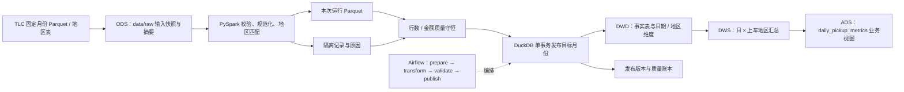

# NYC 出行运营离线数仓

**NYC Taxi Operations Offline Warehouse** — a reproducible, single-machine data engineering project built with PySpark, DuckDB and Airflow. It processes fixed 2024 Q1 Yellow Taxi snapshots into reconciled monthly facts and daily pickup-zone metrics, with idempotent publication, backfill and a controlled join benchmark.

一个适合 16 GB Windows + Docker Desktop/WSL2 开发机的离线数据工程项目。固定处理 NYC Yellow Taxi 2024 年 Q1 数据，展示月度处理、事实/维度建模、质量隔离、历史补跑、事务发布和受控 Spark Join 实验。不是实时系统，不依赖 GPU、云集群、MinIO 或业务 API。

项目入口：[源码](https://github.com/CedricGrey777/nyc-taxi-warehouse) · [验证记录](VALIDATION.md) · [当前证据](evidence/2026-11-02/warehouse-verification.json) · [CI](https://github.com/CedricGrey777/nyc-taxi-warehouse/actions/workflows/ci.yml) · [MIT 许可证](LICENSE)

## 历史实测与当前验证

[2026-09-09 实测记录](VALIDATION.md) 记载 Q1 原始记录 **9,554,778** 条，接纳 **9,436,037** 条，隔离／业务排除 **118,741** 条；当次完整测试为 **9 passed**。固定一月 2,928,237 条接纳记录的 Join 实验中，Sort-Merge / Broadcast 的五次耗时中位数分别为 **1.649809 / 0.451515 秒**，两种策略的 1,301 个结果分组一致。

2026-11-02 已只读复核三个月的事实与指标，结果与上述历史规模一致，并导出 [质量汇总与历史 Join 原始证据](evidence/2026-11-02/warehouse-verification.json)。本轮聚焦合同测试 **5 passed in 0.02s**、完整测试 **9 passed in 13.20s**，合成 CLI 验证 **9＝3＋6、接纳金额 25.00 美元**，`pip check` 无依赖冲突；[验证记录](VALIDATION.md) 提供日志和实测命令。Join 耗时仍为 2026-09-09 的测量，本轮未重跑性能实验。

[GitHub Actions](https://github.com/CedricGrey777/nyc-taxi-warehouse/actions/workflows/ci.yml) 展示对应提交的合成数据测试结果；它不重测 Q1 处理规模或历史性能数字。

## 业务与数据口径

运营人员可查询日/上车地区的三个指标：

| 指标 | 定义 | 边界 |
|---|---|---|
| 出行记录量 | 接纳集合的记录数 | 没有可信 `trip_id`，不声称唯一真实行程或独立乘客 |
| 记录收费总额 | `SUM(total_amount)`，按 `DECIMAL(18,2)` 规范为分币精度 | 不含未记录的现金小费；不是企业净收入 |
| 平均记录行程距离 | 距离合计 / 记录数，英里 | 汇总时重算分子分母，不平均局部均值 |

事实粒度是一条公开源记录；相同字段的记录保留，只统计重复样式。幂等由目标月份替换实现，不能通过删除“疑似重复”修复重复导入。源文件 SHA-256 只识别输入快照，不生成业务行程 ID。

固定 1/2/3 月可演示先发布 1 月和 3 月，再补 2 月；也覆盖 2 月 29 日。不跨 2025 新增费用字段。保留源时间的本地钟面语义，只用日期统计，不把无时区时间戳相减包装成经过 DST 修正的真实行程时长。

## 结构和运行条件



ODS / DWD / DWS / ADS 是本项目的逻辑分层；原始和暂存数据用文件保存，事实、维度、汇总与业务视图落在同一 DuckDB 中。

| 分层 | 实际对象 | 用途 |
|---|---|---|
| ODS 原始层 | `data/raw`、来源 manifest | 固定输入文件与来源摘要 |
| DWD 明细层 | `fact_trip_record`、`dim_date`、`dim_zone` | 接纳记录、日期维度、上/下车地区双角色维度 |
| DWS 汇总层 | `mart_daily_pickup_zone` | 按来源月、上车日期和上车地区聚合 |
| ADS 应用层 | `daily_pickup_metrics` | 展示记录量、记录收费总额、平均记录行程距离 |

- `fact_trip_record`：源月、时间、日期键、地区双角色键、距离、收费、支付方式及运行版本。
- `dim_date`：Q1 的 91 个日期；`dim_zone`：固定地区表与 `-1` Unknown 行。
- `mart_daily_pickup_zone`：日期＋地区；`daily_pickup_metrics`：可查询的业务视图。
- `pipeline_runs` 和 `published_months`：已经提交的版本、来源摘要和质量结果。
- `data/raw` 保存输入；`data/runs/<month>/<run_id>` 保存暂存 Parquet、源 manifest 和隔离结果。

Python 3.11、PySpark 3.5.9、JDK 17、DuckDB 1.4.5。Airflow 3.3.1 的 PostgreSQL 仅保存调度元数据。每次 1 个 DAG、1 个 `local[2]` Spark 作业，驱动堆 3 GB；实际峰值与磁盘需求应以公开数据运行结果测量。

业务数据放 Linux named volume，避免 Spark 在 OneDrive 同步目录工作；项目源码可放当前工作区。Windows 原生 Python 仅适合无 JVM 的检查，完整链路优先容器/WSL2。不要同时在另一进程写同一 DuckDB 文件；查询也应在发布进程结束后执行。

## 最快本地验证：显式合成数据

Windows 使用 PowerShell 7 和 Docker Desktop Linux containers。已有源码时，从项目目录内的构建命令开始：

```powershell
git clone https://github.com/CedricGrey777/nyc-taxi-warehouse.git
cd nyc-taxi-warehouse
docker compose build cli
docker compose run --rm --no-deps cli fixtures --output /opt/airflow/data/demo/fixtures
docker compose run --rm --no-deps cli run-month --month 2024-01 --data-root /opt/airflow/data/demo/warehouse --source /opt/airflow/data/demo/fixtures/yellow_tripdata_2024-01.parquet --zones /opt/airflow/data/demo/fixtures/zones.csv
docker compose run --rm --no-deps cli check --month 2024-01 --data-root /opt/airflow/data/demo/warehouse
```

镜像构建需要下载固定依赖；构建后的这条演示链路只使用本地合成数据，独立保存在 `demo/`，不启动 Airflow 服务。

在具备上述 Python/JDK 的 Linux 环境，项目根目录执行：

```bash
python -m pip install -e '.[test]'
python -m taxi_warehouse fixtures --output /tmp/taxi-demo/fixtures
python -m taxi_warehouse run-month --month 2024-01 --data-root /tmp/taxi-demo/warehouse --source /tmp/taxi-demo/fixtures/yellow_tripdata_2024-01.parquet --zones /tmp/taxi-demo/fixtures/zones.csv
python -m taxi_warehouse check --month 2024-01 --data-root /tmp/taxi-demo/warehouse
```

每月 fixture 仅 9 行，设计期望为 3 行接纳＋6 行隔离；保留 2 条相同记录，接纳金额 25.00，未知地区映射到 `-1`。这些数字是**人工测试样例的预期**，不是公共数据观测结果。

`--source` 和 `--zones` 均显式给出可完全离线执行。省略这两个参数时才从 TLC 下载该月份及地区表；已下载源文件复用固定快照。CLI 不会自动下载 Q1 之外的数据。

```bash
# 有网络且明确需要公开数据时执行；不把下载结果提交到 Git。
python -m taxi_warehouse run-month --month 2024-01 --data-root /opt/airflow/data
```

## Airflow 编排和历史补跑

`dags/nyc_taxi_monthly.py` 使用参数 `month` 和四个 TaskFlow 任务：prepare → transform → validate → publish。DAG `schedule=None`，**没有原生日历 backfill 或自动月度生产调度的承诺**。

`backfill` 是独立范围入口：顺序调用 Airflow REST API 触发指定月，等待成功后才提交下一月；失败/超时停止。超时或网络中断后先查看已提交运行，避免盲目重复提交。每次请求使用独立 run ID 和 `logical_date: null`，允许同月重新执行。

Compose 的具体启动和认证参见同目录 `compose.yaml`。当前配置是仅本机演示的 SimpleAuth all-admins 模式，使用公开的本地演示凭据，API 仅绑定 `127.0.0.1:18080`，不包含真实密钥。

```powershell
# 在 pwsh 中执行。
docker compose up -d --build
# 打开 http://localhost:18080，确认 nyc_taxi_monthly 已加载。
# 本地演示 SimpleAuth 接口：只将 token 存入环境变量，不回显。
$env:AIRFLOW_API_URL = 'http://localhost:18080'
$env:AIRFLOW_API_TOKEN = (Invoke-RestMethod -Method Get -Uri 'http://localhost:18080/auth/token').access_token
python -m taxi_warehouse backfill --from 2024-01 --to 2024-03
```

本地 CLI 的 `run-month` 不依赖 Airflow。容器内可使用 `cli` 工具服务运行：

```bash
docker compose run --rm cli fixtures --output /opt/airflow/data/fixtures
docker compose run --rm cli run-month --month 2024-01 --source /opt/airflow/data/fixtures/yellow_tripdata_2024-01.parquet --zones /opt/airflow/data/fixtures/zones.csv --data-root /opt/airflow/data
```

若要验证 DAG 而不下载公共数据，将 `.env` 的 `TAXI_FIXTURE_ROOT=/opt/airflow/data/fixtures`，先生成上述 fixture，再创建/重建调度容器。默认不设置该变量时 DAG 消费 TLC 数据。

## 质量、发布与恢复

- 硬失败：核心列缺失、文件不可读、地区键重复、接纳为空、行数/金额对账不守恒、事实—指标不一致。
- 隔离：缺失/非法时间、非有限距离、不可解析金额；时间先后使用源钟面语义。
- 业务排除：上车日期不在目标来源月、负金额/距离。保留源数据与排除原因，不把冲销记录武断地说成错误数据。
- 零金额/距离保留；未知地区保留并映射 Unknown，不内关联丢行。
- 每条隔离记录只有一个主原因，额外原因保存在 `all_reasons`，防止多问题行被重复计数。
- 对账：原始数＝接纳数＋隔离数；统一分币口径的可解析金额＝接纳金额＋隔离金额；不可解析金额单独计数。事实/指标行数及收费合计再次核对。

Spark 先完成本运行独立暂存文件。发布使用单个 DuckDB 事务替换目标来源月的事实与指标，并一起更新成功版本。其他月份不处理。地区表是 Q1 固定快照，变化会阻止发布而不会静默改写历史地区含义。

CLI 支持 `--fail-at before_transform|after_quality|after_delete|before_commit|after_commit_response`。前四种在预定阶段失败；事务失败回滚。最后一种在提交和关闭连接后模拟成功响应丢失，数据库成功版本仍存在，客户端状态记 `commit_ack_lost`；先 `check`，重跑不翻倍。数据纠正是修复逻辑后重跑目标月，不声称审计日志等价于自动回滚。

不要直接用全部 run 目录通配符查询：失败/旧版本暂存也在那里，只有 DuckDB 成功版本对业务可见。项目不自动删除历史运行输出；开发过程中定期检查 named volume 磁盘占用，清理前确认需要保留的源与运行证据。

## 测试与一个性能实验

GitHub Actions 在 push、pull request 和手动触发时，于 Ubuntu 24.04 构建现有 Docker 镜像、运行完整测试，再在容器 `/tmp/taxi-ci` 下执行 `fixtures → run-month → check` 离线 CLI 演示。测试沿用项目固定依赖，不下载 TLC 原始数据。

先聚焦再完整验证：

```powershell
docker compose run --rm --no-deps --entrypoint python cli -m pytest -q tests/test_contracts.py
docker compose run --rm --no-deps --entrypoint python cli -m pytest -q
```

本轮合成 CLI 与依赖检查的完整命令见 [2026-11-02 验证记录](VALIDATION.md)。有已发布的真实一月数据时，可另行执行 `docker compose run --rm --no-deps cli benchmark --month 2024-01 --data-root /opt/airflow/data --repetitions 5`；本轮没有重复该历史性能实验。

完整测试启动真实 Spark，不是 mock 转换。覆盖明确合成样例、重复保留、未知地区、闰日、多原因隔离、来源字段缺失、维度键重复、事实/指标对账、先 1/3 月再补 2 月、同月重跑和事务失败。Airflow REST 测试使用隔离 stub 检查请求/顺序/失败停提；它不代表已经验证真实 Airflow 服务。

Benchmark 对同一已发布月做地区双角色 Join 与聚合，固定 `local[2]` 和 shuffle 分区，关闭 AQE/自动广播来受控比较显式 BroadcastHashJoin 和 SortMergeJoin。两种物理节点必须实际出现，结果必须相同。预热后交错执行，写出每次耗时、中位数、物理计划和 SQL operator metrics（包含可用 Shuffle 指标）。不计下载/JVM 启动时间，不宣称冷缓存或生产分布式性能；结果无提升也如实记录。合成 9 行只验证实验可运行，有意义的性能结论需要真实固定月份数据。

## 参考来源与个人贡献边界

核验日期：2026-09-09。

- [参考项目](https://github.com/Yarroudh/dataengineering)：借鉴分层和 Spark 编排思路，原代码是单月处理及 DuckDB 覆盖，本实现新增事务化月替换、质量守恒、版本指针、故障注入与自动化验收；不是原仓库简单改名。
- [TLC 官方源数据](https://www.nyc.gov/site/tlc/about/tlc-trip-record-data.page)：公开 Parquet、地区表、字段变化与准确性说明。
- [官方黄色出租车数据字典](https://www.nyc.gov/assets/tlc/downloads/pdf/data_dictionary_trip_records_yellow.pdf)：金额和现金小费口径。
- [参考仓库许可证](https://github.com/Yarroudh/dataengineering/blob/main/LICENSE)：参考代码 MIT；数据使用仍应遵循来源条款，不将代码许可证当成数据许可证。

本仓库源码按 [MIT](LICENSE) 发布。独立贡献包括输入与指标口径、质量守恒、未知地区保留、按月事务替换、版本账本、故障注入与补跑验收；Spark、Airflow 和 DuckDB 的框架能力及 TLC 原始数据不计作个人实现。代码许可证不适用于 TLC 数据，原始数据和本地运行明细不提交到仓库。

简历中的规模、测试数量和性能结果对应 [VALIDATION.md](VALIDATION.md) 的具名运行及环境。面试可据此解释无 ID 时的粒度选择、按月处理与行级 CDC 的区别、事务边界、金额口径及广播 Join 的测量证据。
